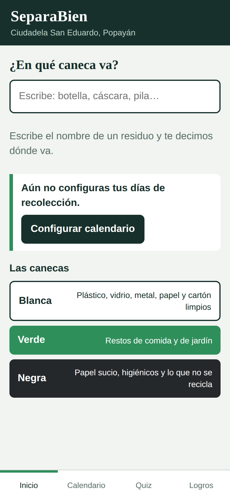
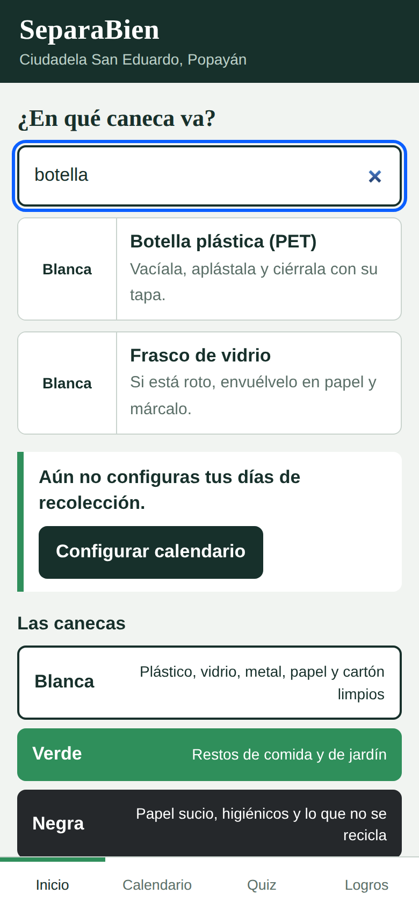
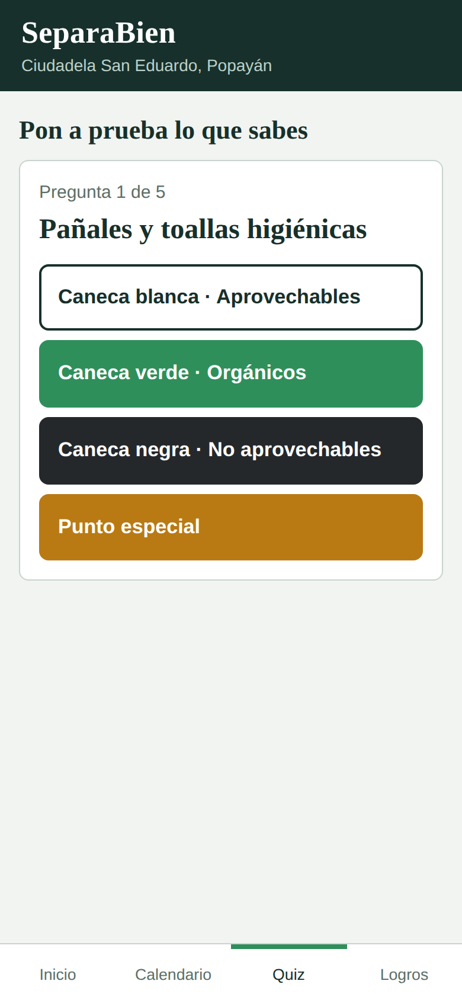
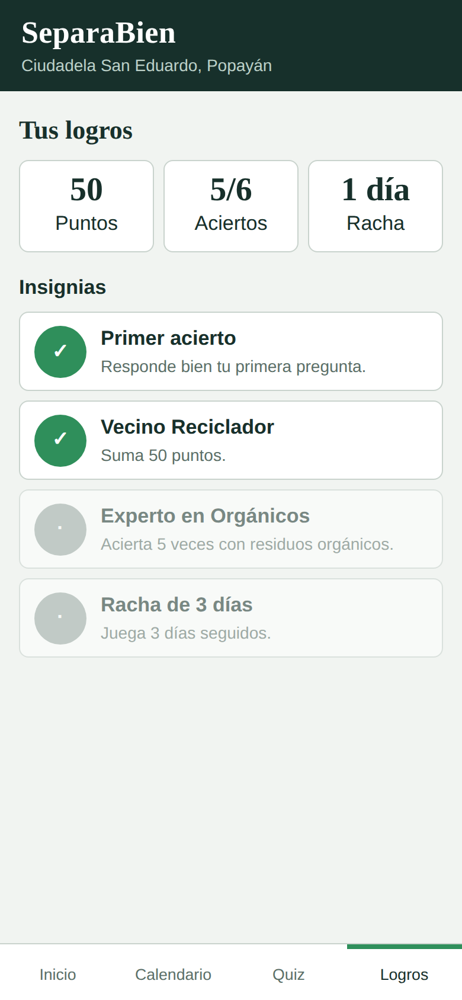

# SeparaBien ♻️

> **EN:** A lightweight, offline-first progressive web app (PWA) that helps residents of Ciudadela San Eduardo (Popayán, Colombia) sort their waste correctly, with a collection calendar, a quiz game, streaks and badges. No dependencies, ~29 KB.

**SeparaBien** es una aplicación web progresiva (PWA) para que los vecinos de la Ciudadela San Eduardo, en Popayán, sepan en qué caneca va cada residuo. Es el proyecto aplicado de Trabajo de Grado de Tecnología en Desarrollo de Software (UNAD).

- **Demo:** https://fernando9011.github.io/separabien/ *(ajusta el enlace con tu usuario)*
- **App instalable:** https://fernando9011.github.io/separabien/app/
- **Informe técnico (PDF):** [docs/Fase3_SeparaBien_Implementacion.pdf](docs/Fase3_SeparaBien_Implementacion.pdf)

## Funcionalidades

| Función | Descripción |
|---|---|
| Buscador | 27 residuos; dice la caneca y cómo prepararlo (sin importar tildes ni mayúsculas) |
| Calendario | El vecino marca qué se recoge cada día y ve la próxima recolección |
| Recordatorio | Aviso opcional la víspera de la recolección |
| Juego | Rondas de 5 preguntas con retroalimentación inmediata y 10 puntos por acierto |
| Logros | Racha de días seguidos y 4 insignias |
| Sin conexión | Service worker: funciona sin internet tras la primera visita |
| Privacidad | Sin registro ni datos personales; todo se guarda en el dispositivo |

## Capturas

<p>
  
  
  
  
</p>

## Tecnologías

HTML5, CSS3 y JavaScript sin librerías externas · Service Worker y Web App Manifest · `localStorage` · Node.js (solo para las pruebas).

## Estructura

```
separabien/
├── index.html          # página de presentación del proyecto
├── app/                # la aplicación (PWA)
│   ├── index.html      # interfaz
│   ├── logic.js        # lógica: búsqueda, quiz, racha, insignias, calendario
│   ├── sw.js           # service worker (uso sin conexión)
│   ├── manifest.webmanifest
│   └── tests/          # pruebas de unidad e integración
└── docs/               # informe PDF, diagramas UML y capturas
```

## Ejecutar en local

```bash
# servir la carpeta (los service workers requieren http, no file://)
python -m http.server 8000
# abrir http://localhost:8000/ y http://localhost:8000/app/
```

## Pruebas

```bash
node app/tests/test_logic.js
```

La lógica (`logic.js`) está separada de la interfaz, por lo que se prueba sin navegador: 19 pruebas de unidad y 4 de integración. Además se validó la app completa en un navegador (20 validaciones: búsqueda, calendario, juego, persistencia, uso sin conexión y pantallas de 320 px). Detalles en el [informe](docs/Fase3_SeparaBien_Implementacion.pdf).

## Diseño

Diagramas en [`docs/diagramas`](docs/diagramas): casos de uso, clases, flujos, arquitectura y modelo de datos para una fase futura con base de datos en la nube.

## Metodología

Design Thinking (empatía y definición del problema), Lean Startup (MVP y ciclo crear-medir-aprender) y gamificación, dentro de un enfoque ágil con ciclos semanales.

## Hoja de ruta

- [ ] Prueba de usabilidad con vecinos voluntarios
- [ ] Probar el recordatorio en dispositivos reales
- [ ] Mapa de puntos de acopio
- [ ] Base de datos en la nube (Firebase o Supabase)

## Convención de commits

Este repositorio usa [Conventional Commits](https://www.conventionalcommits.org/es/v1.0.0/): `feat:`, `fix:`, `docs:`, `test:`, `chore:`…

## Autoría y licencia

Proyecto académico de Trabajo de Grado, Universidad Nacional Abierta y a Distancia (UNAD). Autor/a: **Daniliz Fernando Gómez Pinto - https://github.com/Fernando9011**.
Licencia [MIT](LICENSE).
